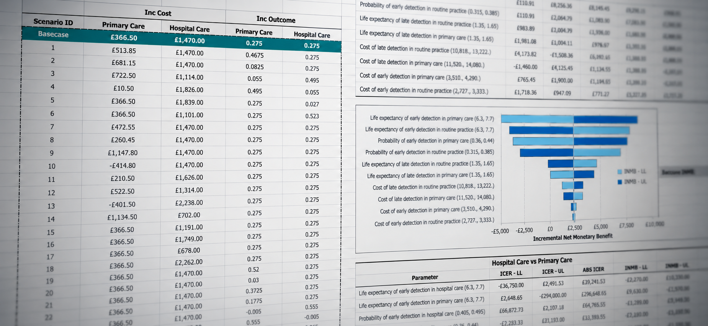

# Health-Economics-OWSA-Without-VBA

  

An Excel-based framework for one-way sensitivity analysis (OWSA) in health economic models using What-If Analysis and Dynamic Array Function, without VBA.

This framework is created in Microsoft® Excel for Mac, Version 16.112.3 (26083020).

An illustrative guidance will be uploaded later.
